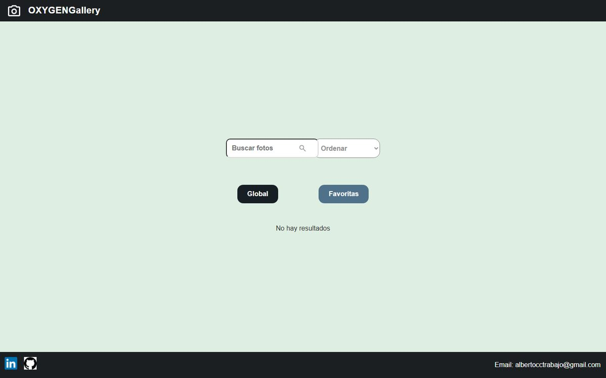

<div align="center">

# OXYGENGallery

**Buscador de fotos sobre la API de Unsplash con colección de favoritas propia.**

Proyecto del Training React Full Stack de OXYGEN · Módulo 3 (React y Redux)


**[Ver demo en vivo](http://oxygengallery.s3-website.eu-west-3.amazonaws.com/)**



</div>

---

## Qué es

Una SPA en React para buscar fotos en Unsplash, guardarlas como favoritas y gestionarlas: editar su descripción, filtrarlas, descargarlas o eliminarlas. Las favoritas se guardan en el navegador (`localStorage`), así que siguen ahí al recargar la página.

## Funcionalidades

**Vista Global (búsqueda en Unsplash)**

- Búsqueda en tiempo real mientras se escribe (12 resultados por página).
- Botón **Cargar más** para pedir la siguiente página de resultados.
- Ordenación por **fecha**, **ancho**, **alto** o **likes**.
- Por cada foto: añadir o quitar de favoritas, **descargar** la imagen a tamaño completo (`file-saver`) y abrir un **modal de información** (fecha, dimensiones, likes y descripción).

**Vista Favoritas**

- Se activa con el botón *Favoritas* y cambia el color de fondo para distinguirla.
- El buscador pasa a filtrar **por descripción** dentro de tus favoritas.
- Desde el modal se puede **editar y guardar la descripción** o **eliminar** la foto de favoritas.
- Persistencia en `localStorage`.

**General**

- Layout común con cabecera y pie (enlaces a LinkedIn y GitHub) mediante React Router y `<Outlet />`.
- Desplegada como web estática en un bucket de **Amazon S3**.

## Stack

| Capa | Tecnología |
| --- | --- |
| UI | React 18, CSS por componente |
| Estado | Redux Toolkit + React Redux (store y slices) y estado local con hooks |
| Rutas | React Router |
| Datos | API REST de Unsplash (`/search/photos`) con `fetch` |
| Utilidades | `file-saver` para las descargas |
| Tooling | Vite 6, ESLint 9 |
| Despliegue | Amazon S3 (static website hosting) |

## Estructura

```
src/
├── components/      Header, Footer y Modal (detalle / edición)
├── layouts/         MainLayout (cabecera + <Outlet /> + pie)
├── pages/
│   ├── Search/      Vista principal: búsqueda global y favoritas
│   └── Favoritas/   Página de favoritas en la ruta /favoritas
├── services/        unsplash.js, llamada a la API de búsqueda
├── slices/          store de Redux y slices (favorites, search)
├── styles/          estilos globales
└── images/          iconos de la interfaz
```

## Puesta en marcha

Requisitos: Node.js 18 o superior y una **Access Key** de Unsplash ([unsplash.com/developers](https://unsplash.com/developers)).

```bash
git clone https://github.com/albertocalerocastillo/OXYGENGallery.git
cd OXYGENGallery
npm install
npm install react-router-dom   # se usa en App.jsx pero no figura en package.json
```

Pon tu propia Access Key en la constante `ACCESS_KEY` de `src/services/unsplash.js` y arranca:

```bash
npm run dev       # servidor de desarrollo en http://localhost:5173
npm run build     # build de producción en dist/
npm run preview   # sirve el build localmente
npm run lint      # ESLint
```

Para desplegar en S3 basta con subir el contenido de `dist/` a un bucket con *static website hosting* activado.

## Qué aprendí

- Consumir una API REST externa con `fetch` y `async/await`, gestionando la paginación y los errores.
- Montar un store con **Redux Toolkit** (`configureStore`, `createSlice`, `createAsyncThunk`) y decidir qué estado debe ser global y cuál local.
- Persistir datos del usuario en `localStorage` y sincronizarlos con el estado de React.
- Componer la interfaz con layouts y rutas anidadas de React Router.
- Publicar una SPA como web estática en Amazon S3.

---

<div align="center">

Hecho por **Alberto Calero** · [github.com/albertocalerocastillo](https://github.com/albertocalerocastillo)

</div>
